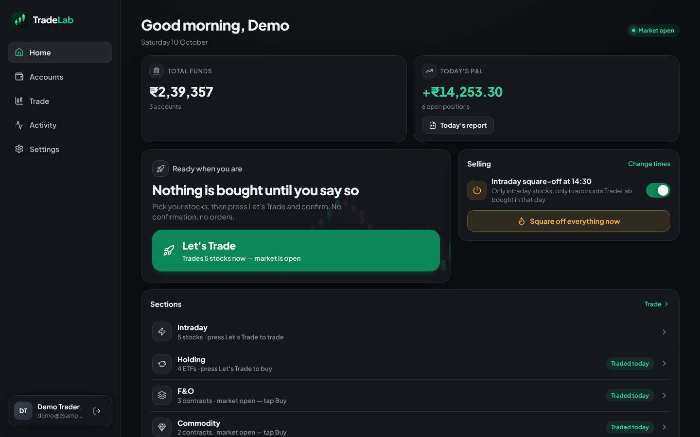
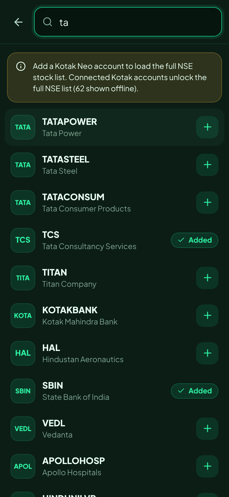
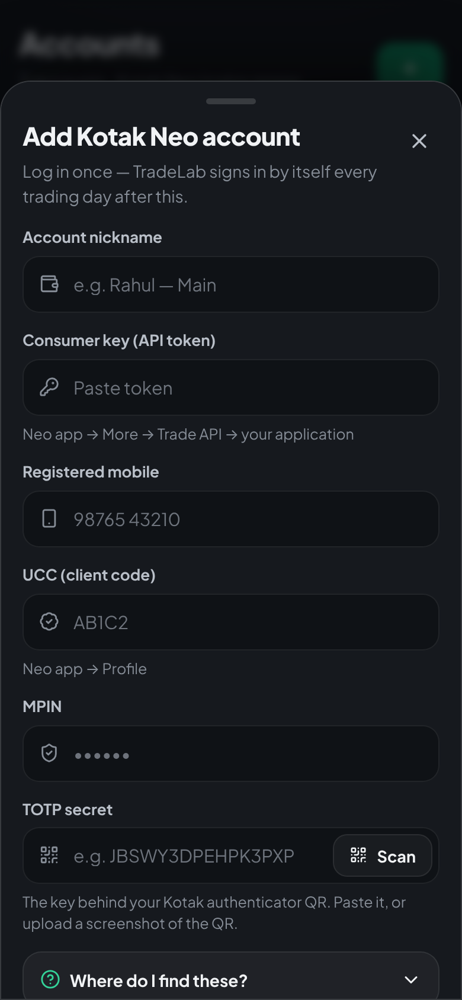

# TradeLab — intraday autopilot for many Kotak Neo accounts

TradeLab is a private app for running the same intraday plan across all your Kotak Neo demat accounts:

- **09:15:00 IST**: market orders (intraday/MIS) for every stock you picked, in every account, all at once.
- **14:30:00 IST**: a hard square-off. Pending orders are cancelled, every open position is closed at market price, and the app checks that the account is flat.

It installs like a normal app on **Android** and **Windows**, and only people who have your private access code can create an account.

| Dashboard | Search stocks (Android) | Add account (Android) |
|---|---|---|
|  |  |  |

---

## What it does

| You asked for | How TradeLab does it |
|---|---|
| Add, rename and delete accounts. An account can be deleted only at ₹0 balance | **Accounts** page. Before deleting, TradeLab asks Kotak for the live balance. It refuses unless the balance is exactly **₹0.00** and there are no open positions. If the balance can't be checked (for example, the login is broken), it also refuses. |
| Log in to each demat account once, never again | You enter the account's Trade API details once: consumer key, mobile, UCC, MPIN and TOTP secret. TradeLab tests the login right away, then stores the details encrypted. Every trading day it generates the 6-digit TOTP itself and logs in at 09:00. If Kotak ends a session, it logs in again automatically. |
| Pick stocks, market buy at 09:15, hard sell at 14:30 | **Stocks** page has a search over every NSE equity from Kotak's scrip master. You can choose which accounts trade each stock and whether to buy or short. Square-off is retried up to 3 times until the account is flat. |
| Split each account's money equally across the day's stocks and buy the maximum shares | This is the default (**Stocks → Money per stock → Split funds equally**). A minute before entry, TradeLab reads each account's available funds and divides them by the number of stocks that account will trade. For each stock it buys as many shares as fit in that part. Example: ₹1,00,000 and 10 stocks gives ₹10,000 per stock, so a ₹245 stock gets 40 shares. A stock whose single share costs more than its part is skipped. **Preview orders** shows the exact quantities beforehand. |
| Sign up and log in (no admin) | Anyone with the access code can create an account and use it straight away; there is no approval step and no admin panel. Each person gets a private space. |
| Completely private | No public pages. Creating an account needs the private access code (`TRADELAB_SIGNUP_CODE`), and search engines are blocked (`noindex`, `robots.txt`). Each user sees only their own accounts. Kotak credentials are encrypted at rest. |
| Green "bullish candle" look, pleasant to use | Dark and light themes, animated candlestick visuals, a live countdown to the next 09:15 or 14:30 event, and a layout that works on phone and laptop. |

Other features:

- **Autopilot switch on every account.** Turn an account off and it is left out of both entry and exit.
- **Global switches.** Turn the 09:15 entry and the 14:30 exit on or off, and change the times.
- **"Buy basket now" and "Square off all"** buttons, plus square-off for a single account.
- **Positions and orders view** for each account, with funds and today's P&L across all accounts.
- **Activity log** showing every order: placed, failed or skipped, and why.
- **Per-stock sizing** (optional): switch to **Set per stock** to give each stock a fixed number of shares, a ₹ amount or a % of funds.
- **Keep aside**: an optional % of each account's money that the equal split leaves untraded.
- **Holiday calendar** in Settings, shared by everyone on the server. Weekends are skipped automatically.
- **Paper (practice) accounts** to dry-run the whole flow without real money.

---

## How it works

```
 Android phone ─┐                         ┌───────────── your server (always on) ─────────────┐
                ├── HTTPS ──▶ Caddy ──▶   │  TradeLab API + scheduler (Python, FastAPI)        │ ──▶ Kotak Neo Trade API
 Windows laptop ┘                         │  SQLite DB (encrypted Kotak logins)                │     (official kotakneoapi SDK)
                                          └────────────────────────────────────────────────────┘
```

Orders are placed by the **server**, not by your phone. Your phone and laptop can be switched off at 09:15; the trades still happen.

Daily timeline (IST, Mon–Fri, skipping holidays):

| Time | What happens |
|---|---|
| 09:00 | Logs in to every autopilot account and refreshes the NSE stock list |
| 09:14:00 | Prepares: checks sessions, reads each account's available funds and the latest prices, works out the shares per stock |
| **09:15:00** | Sends every MKT / MIS / DAY order in parallel across all accounts |
| **14:30:00** | For each account: cancel pending orders → close every open position at market → re-check, up to 3 attempts |

If the server was down at 14:30 and comes back before 15:20, it squares off immediately. The entry runs at most once per day. Two square-offs can never run at the same time, so a position is never closed twice by mistake.

---

## Setup

### 1. Prepare each Kotak Neo account (once per account)

In the **Kotak Neo app**:

1. Go to **More → Trade API** and create an application. Copy its token; this is the **consumer key**.
2. On the same screen, **register TOTP**. When the QR code appears, **take a screenshot of it** (or copy the key shown with it) before scanning it into Google Authenticator. TradeLab needs that secret to log in by itself. On the "Add account" screen you can upload the screenshot and the secret is read from the QR code.
3. Note your **UCC** (Profile) and your **MPIN**.
4. If the Trade API dashboard asks for a **static IP**, enter your server's public IP (step 2 below).

> API trading in India is regulated (SEBI's framework for retail algo/API trading), and brokers can require static-IP registration and other steps. Check Kotak Neo's current Trade API terms for your accounts.

### 2. Run the server

You need a small always-on Linux server, ideally in the **Mumbai** region (low latency to NSE) with a **static IP**. For example, a 1 vCPU / 1–2 GB VPS from AWS Lightsail, DigitalOcean or Azure. Point a domain or subdomain (for example `trade.yourdomain.com`) at its IP.

```bash
# on the server (with Docker installed)
git clone <this repo> tradelab && cd tradelab
cp .env.example .env
nano .env          # set DOMAIN and TRADELAB_SIGNUP_CODE
docker compose up -d --build
```

Caddy gets an HTTPS certificate automatically. Open `https://your-domain`, choose **Create an account** and enter the access code you set as `TRADELAB_SIGNUP_CODE`.

**To share TradeLab**, send someone the address and the access code. They create their own account and get their own private space for their accounts, stocks and schedule. To stop new sign-ups, change the code in `.env` and run `docker compose up -d`. People who already have an account keep it, because there is no admin to remove them.

**Back up the `tradelab-data` Docker volume.** It holds the database and the encryption key. If the key is lost, every account has to be added again.

### 3. Add accounts and stocks

1. **Accounts → Add account → Kotak Neo (live).** Enter the details from step 1. TradeLab logs in immediately, and if it says *Connected*, you're done with that account for good.
2. **Stocks → Search all NSE stocks.** Add your stocks. By default each account's money is split equally between them; tap **Preview orders** to see the exact shares per account.
3. On **Home**, check that *Market buy at 09:15* and *Hard square-off at 14:30* are switched on.
4. In **Settings → Market holidays**, add the NSE trading holidays.

**Do a test run first.** Add a *Paper (practice)* account and use **Buy basket now**, then **Square off all**. Next, do one live day with a single share per stock before scaling up.

### 4. Install the app

- **Android**: open your domain in Chrome, then **⋮ → Install app** (or *Add to Home screen*).
- **Windows**: open your domain in Edge or Chrome, then click the **Install** icon in the address bar. TradeLab then opens from the Start menu like any other app.

---

## Running it on your own PC (optional)

`start-local.bat` (Windows) or `./start-local.sh` (Linux/macOS) runs everything on `http://localhost:8000`. You need Python 3.11+ and Node.js 20+.

Orders only fire while that PC is on and awake at 09:15 and 14:30. That is why a small always-on server is the recommended setup.

---

## Configuration (`.env`)

| Variable | Default | Meaning |
|---|---|---|
| `DOMAIN` | — | Domain Caddy serves over HTTPS |
| `TRADELAB_SIGNUP_CODE` | — | Private access code needed to create an account. **Set this** on any server others can reach; if empty, anyone who opens the address can sign up. |
| `TRADELAB_SECRET_KEY` | auto-generated in the data volume | Encrypts stored Kotak credentials and signs logins |
| `TRADELAB_ENABLE_PAPER_TRADING` | `true` | Allow practice accounts |
| `TRADELAB_TOKEN_TTL_HOURS` | `168` | How long a device stays logged in |
| `TRADELAB_DATA_DIR` | `/data` in Docker | Database, key and caches |

Run **exactly one** server process. The scheduler lives inside it, so more workers would fire orders more than once.

---

## Development

```bash
# backend
cd backend
python -m venv .venv && . .venv/bin/activate
pip install -r requirements-dev.txt
pytest                                   # 56 tests: sign-up code, equal split, ₹0 delete rule, entry timing, square-off, Kotak adapter, DB upgrade
uvicorn app.main:app --reload            # http://127.0.0.1:8000

# frontend (separate terminal)
cd frontend
npm install
npm run dev                              # http://localhost:5173, proxies /api to :8000
```

Project layout:

```
backend/app/
  broker/kotak.py      Kotak Neo adapter (official kotakneoapi SDK: TOTP login, orders, positions, limits, quotes, scrip master)
  broker/paper.py      Simulated broker for practice accounts
  broker/manager.py    One session per account, automatic daily / on-expiry re-login
  services/trading.py  09:15 entry engine and 14:30 square-off engine
  services/scheduler.py APScheduler jobs (IST), catch-up after restarts
  services/scrips.py   NSE instrument list + search
  routers/             auth, accounts, stocks, basket, automation, holidays
frontend/src/          React + TypeScript PWA (pages/, components/, lib/)
```

## Notes and limits

- The Kotak integration follows the official SDK (`kotakneoapi` 3.0.7) and its documented responses. It was tested against that SDK with mocked HTTP responses, not against a live Kotak account. **Do a paper run and a 1-share live run first.**
- Orders are intraday (**MIS**) market orders with DAY validity. Kotak's own risk system also auto-squares MIS positions near 15:15–15:20, so keep the exit time before that.
- "Square-off closes **Everything**" (the default) closes every position Kotak lists for the account, including delivery (CNC) or F&O positions that show up there. Switch to **Intraday (MIS) only** in Settings if you don't want that.
- Holidays are not loaded automatically. Add them in **Settings → Market holidays** each year.
- **Equal split uses the full available amount by default.** If prices jump at the open, Kotak can reject an order for insufficient funds. Market orders at 09:15 can fill at a different price than the quote taken a minute earlier. Set a small **Keep aside** (for example 2%) if you see such rejections in Activity.
- Upgrading from the earlier version with the admin panel: on first start, users who were still waiting for approval or had been revoked are removed, and everyone else keeps their accounts.
