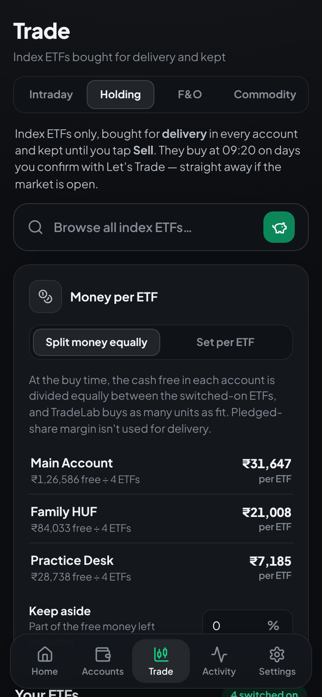
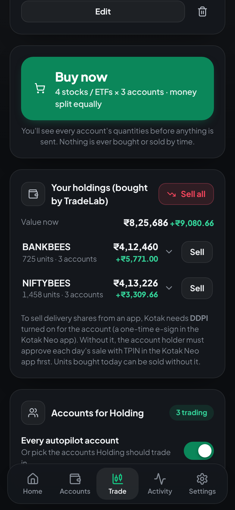
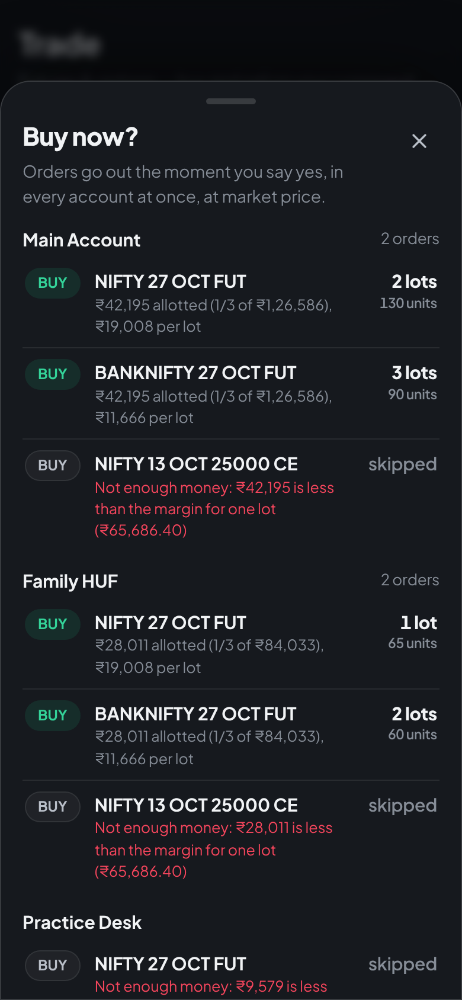
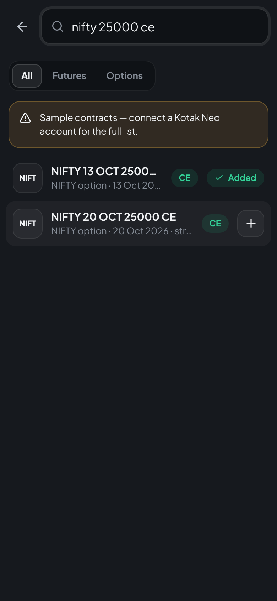

# TradeLab — one trade, every Kotak Neo account

TradeLab is a private app that places the same trade in all your Kotak Neo demat accounts at once, and divides each account's money for you. It has four sections, each with its own list, accounts and settings:

| Section | What it trades | How it buys | How it sells |
|---|---|---|---|
| **Intraday** | NSE/BSE stocks (MIS) | at 09:15 on days you confirm with **Let's Trade** | hard square-off at 14:30 |
| **Holding** | any NSE stock or ETF (delivery, CNC) | the moment you tap **Buy now** and confirm | the moment you tap **Sell** |
| **F&O** | NSE and BSE futures and options, in lots — each can be bought or **sold first** | the moment you tap **Buy now** and confirm | the moment you tap **Exit** (sells what was bought, buys back what was sold first) |
| **Commodity** | MCX gold, silver, crude oil and more (futures and options), in lots — each can be bought or **sold first** | the moment you tap **Buy now** and confirm | the moment you tap **Exit** |

**Only Intraday works by the clock.** Holding, F&O and Commodity never buy or sell by time: they use delivery (CNC) and carry-forward (NRML) orders, which Kotak doesn't square off at the end of the day, and TradeLab has no timed jobs for them.

In every section, the money free in each account at that moment (less an optional keep-aside %) is split equally between the section's items. Sections never touch each other's positions: **Sell (or Exit in F&O) only closes what that section itself opened**, never anyone's own shares or contracts.

It installs like a normal app on **Android** and **Windows**. Everyone who uses it signs in with their own email and password and sees only their own accounts.

| Home | Holding (Android) | Holdings and Sell (Android) | F&O: Buy now (Android) | Contract search (Android) |
|---|---|---|---|---|
|  |  |  |  |  |

---

## What it does

| You asked for | How TradeLab does it |
|---|---|
| Add, rename and delete accounts. An account can be deleted only at ₹0 balance | **Accounts** page. Before deleting, TradeLab asks Kotak for the live balance. It refuses unless the balance is exactly **₹0.00** and there are no open positions. If the balance can't be checked (for example, the login is broken), it also refuses. |
| Log in to each demat account once, never again | You enter the account's Trade API details once: consumer key, mobile, UCC, MPIN and TOTP secret. TradeLab tests the login right away, then stores the details encrypted. Every trading day it generates the 6-digit TOTP itself and logs in at 09:00. If Kotak ends a session, it logs in again automatically. |
| Sub-sections (Holding, Intraday, F&O, Commodity), each with the same system and unhindered by the others | **Trade** page with a tab per section. Each section has its own list, its own accounts (all autopilot accounts, or the ones you pick), its own money settings and its own runs in Activity. Money isn't reserved per section: each one uses whatever is free in each account when it trades, split equally between its items. Every order is recorded with its section, and **Sell** (**Exit** in F&O and Commodity) closes the smaller of what that section opened and what Kotak shows — so a family member's own holdings, or another section's positions, are never sold. The Intraday square-off closes only intraday (MIS) stock positions; delivery, MTF and carry-forward positions are never squared off. |
| Holding: stocks and ETFs, never squared off, bought and sold only when I say | **Trade → Holding** has **Search all NSE stocks** (every stock in NSE's regular EQ series; trade-for-trade BE/T2T stocks aren't listed) and **Browse ETFs**: every ETF on NSE, grouped — stock-market index ETFs first (Nifty, Bank, IT, Midcap, Next 50, Sensex, international; most traded on top), then bond & gilt, gold & silver, and liquid ETFs. **Buy now** shows every account's quantities first, then buys for delivery from **cash** (margin from pledged shares isn't used), with 1.5% left for charges. **Your holdings** shows what TradeLab bought in each account with its live value; **Sell all** or **Sell** one. Nothing in Holding ever happens by time. |
| F&O and Commodity on command | Search contracts (e.g. *NIFTY 25000 CE*, *BANKNIFTY FUT*, *GOLDM*, *CRUDEOIL*). **Buy now** shows every account's lots first ("Are you sure?"), then buys in all of them at once: each account's free money is split equally between the contracts and divided by Kotak's margin for one lot (asked at the latest price). Orders are always **carry forward (NRML)**, so nothing is closed by time; intraday (MIS) isn't offered because Kotak squares MIS off near the close. Set a cap on lots per order, or **Fixed lots** per contract (still capped by the money free). **Any contract can be sold first** — a future (going short) or a call or put (option writing): tap **Edit** on it and choose **Sell first**. Selling first is sized with Kotak's margin for selling one lot and may use margin from pledged shares; buying options uses cash only, because the premium is paid in full. The confirmation shows a red risk warning whenever an order sells first. Kotak nets an order against an open position in the same contract, so TradeLab never sends one against the account holder's own position: an account that already holds the contract (bought outside TradeLab) is skipped when selling first, and one that already sold it first is skipped when buying. **Exit** closes only what TradeLab opened: it sells what it bought and buys back what it sold first, never more than Kotak shows. Buy and sell 09:15–15:25 (MCX 09:00–23:25) on trading days. Each position shows its expiry date: a contract still open then (not sold, or not bought back) is settled by the exchange on expiry day — except that Kotak closes MCX gold, silver and metal futures earlier, and a sold MCX option that ends in the money becomes a future TradeLab doesn't track (see the notes below). |
| A small red pop-up naming accounts that couldn't trade for lack of funds | After every buy (timed or on command), accounts where an order was skipped or rejected for lack of money are named in a red pop-up at the top of every page. It stays until you close it. Kotak's own "RMS: Margin Exceeds" and "Insufficient balance" rejections are caught too, even when they arrive a moment after the order was accepted. |
| Pick stocks, market buy at 09:15, hard sell at 14:30 | **Trade → Intraday** has a search over every NSE equity from Kotak's scrip master. Your list stays from day to day; switch stocks on or off, choose which accounts trade each one and whether to buy or short. Square-off is retried up to 3 times until the account is flat. |
| Nothing trades until I press **Let's Trade** and confirm | A big **Let's Trade** button (Home and Trade) opens **"Are you sure?"** with the day, stocks, accounts and money split. Only after **Yes** can that day's 09:15 buy happen. Exactly the confirmed stocks and accounts are traded (an account added or switched on later is left out), and if anything changed while the dialog was open, **Yes** asks you to review it again. Every trading day needs a new confirmation. Without one, TradeLab sends **no orders at all**: no buys, and no 14:30 square-off. The automatic square-off only runs in accounts where TradeLab itself bought (or may have bought) that day, so trades you place yourself in other accounts are never touched by it. |
| Automatic holiday detection | TradeLab downloads NSE's trading-holiday calendar every morning, so Let's Trade always targets the next real trading day. Just before every buy, including a "buy now" confirmation during market hours, it also checks live prices of large stocks. If the market is clearly closed, it skips the day with no orders. To avoid skipping a real day by mistake, it re-checks 20 seconds after the open first. |
| Split each account's money equally across the day's stocks and buy the maximum shares | This is the default (**Trade → Intraday → Money per stock → Split funds equally**). A minute before entry, TradeLab reads each account's available funds and divides them by the number of stocks that account will trade. For each stock it buys as many shares as fit in that part. Example: ₹1,00,000 and 10 stocks gives ₹10,000 per stock, so a ₹245 stock gets 40 shares. A stock whose single share costs more than its part is skipped. **Preview orders** shows the exact quantities beforehand. |
| A daily Excel report with a sheet per account: stocks, quantity, buy and sell price, P/L per stock and net profit; download all; auto-delete after 2 weeks | **Today's report** on Home (under Today's P&L) downloads `TradeLab-PnL-<date>.xlsx`. It opens on a **Summary** sheet (each account's net profit, linked to its sheet, and the day's total), followed by **one sheet per account**, named after the account: Stock, Quantity, Buy price, Sell price and P/L for every stock traded that day, with **Net profit** at the bottom. The totals are formulas with their results saved in the file, so phone previews and Excel's Protected View show the numbers too. Positions that are still open, or were sold and not bought back, are flagged in a Note column, and an account that couldn't be read is listed in red on the Summary. On trading days (from 09:00) today's file is read live from Kotak when you download it; after the 14:30 square-off (and again at 15:40) each day is saved, so **Activity → Daily P&L reports** lists the last 14 days. **Download all** at the bottom gets every listed day in one zip. Reports are **deleted automatically after 2 weeks**: nothing is stored as a file, and the saved rows behind older reports are removed from the server every night. Amounts are Kotak's P/L before brokerage and taxes. |
| Sign up and log in | Create an account with name, email and password and you're in straight away. Each person gets a private space. |
| Private | Nothing is visible without logging in, and search engines are blocked (`noindex`, `robots.txt`). Each user sees only their own accounts, stocks and trades. Kotak credentials are encrypted at rest. |
| A pleasant look that works on phone and laptop | Calm dark and light themes in neutral greys. Green is kept for buttons, switches and gains, red for losses. The dashboard shows a live countdown to the next 09:15 or 14:30 event. |

Other features:

- **Confirm before or during the session.** Pressing Let's Trade in the evening confirms the next trading day. During market hours (after 09:15) it buys straight away, except in the last 5 minutes before the square-off. **Cancel** works right up to the moment the orders go out.
- **No lost orders.** Every order is recorded before it's sent. If Kotak's reply never arrives, the order is marked *outcome unknown* in Activity, and that account is still squared off at 14:30.
- **Autopilot switch on every account.** Turn an account off and it is left out of the next buy. If TradeLab already bought in it that day, it is still squared off at 14:30.
- **Nothing gets stuck.** If the server restarts or the buy time is moved so a confirmed buy can't happen, the app says so and lets you confirm again (it then buys straight away). A square-off cut short by a restart is caught up automatically.
- **Square-off switch.** Turn the automatic 14:30 square-off on or off, and change the buy and sell times.
- **"Square off everything now"** button, plus the same for a single account. It cancels pending intraday orders, closes every intraday (MIS) position, closes the carry-forward F&O and Commodity positions TradeLab opened (selling what it bought, buying back what it sold first), and cancels today's Let's Trade confirmations that haven't bought yet. Delivery holdings are never sold by it.
- **Total funds and today's P&L** across all accounts at the top of Home (open positions are valued at the live price), plus a positions and orders view for each account.
- **Activity log** showing every order: placed, failed or skipped, and why.
- **Per-stock sizing** (optional): switch to **Set per stock** to give each stock a fixed number of shares, a ₹ amount or a % of funds.
- **Keep aside**: an optional % of each account's money that the equal split leaves untraded.
- **Holiday calendar** in Settings: NSE's calendar is loaded automatically, live-detected closures are added, and you can add or remove dates by hand. It is shared by everyone on the server, so only the owner (the first account created) can change it.
- **Paper (practice) accounts** to dry-run the whole flow without real money.

---

## How it works

```
 Android phone ─┐                         ┌───────────── your server (always on) ─────────────┐
                ├── HTTPS ──▶ Caddy ──▶   │  TradeLab API + scheduler (Python, FastAPI)        │ ──▶ Kotak Neo Trade API
 Windows laptop ┘                         │  MongoDB 8 (replica set of one; logins encrypted)  │     (official kotakneoapi SDK)
                                          └────────────────────────────────────────────────────┘
```

Orders are placed by the **server**, not by your phone. Your phone and laptop can be switched off at 09:15; the trades still happen.

Daily timeline (IST, Mon–Fri, skipping holidays):

| Time | What happens |
|---|---|
| 08:30 | Downloads NSE's holiday calendar |
| 09:00 | Refreshes the NSE stock list and logs in the accounts of everyone who confirmed today with Let's Trade |
| 09:14:00 | Only if today was confirmed: checks the market is open, reads each account's available funds and the latest prices (retrying, with other Kotak accounts as backup), and works out the shares per stock. Not confirmed means nothing more happens. |
| **09:15:00** | Sends every MKT / MIS / DAY order in parallel across all accounts |
| **14:30:00** | Only in accounts where TradeLab bought today: cancel pending orders → close every open position at market → re-check, up to 3 attempts |

If the server was down at 14:30 and comes back before 15:05, it squares off immediately. The square-off also waits for a buy that's still being sent. A holiday added by mistake after TradeLab bought cannot stop the square-off. The entry runs at most once per day. Two square-offs can never run at the same time, so a position is never closed twice by mistake.

---

## Setup

### 1. Prepare each Kotak Neo account (once per account)

In the **Kotak Neo app**:

1. Go to **More → Trade API** and create an application. Copy its token; this is the **consumer key**.
2. On the same screen, **register TOTP**. When the QR code appears, **take a screenshot of it** (or copy the key shown with it) before scanning it into Google Authenticator. TradeLab needs that secret to log in by itself. On the "Add account" screen you can upload the screenshot and the secret is read from the QR code.
3. Note your **UCC** (Profile) and your **MPIN**.
4. If the Trade API dashboard asks for a **static IP**, enter your server's public IP (step 2 below).

> API trading in India is regulated (SEBI's framework for retail algo/API trading), and brokers can require static-IP registration and other steps. Check Kotak Neo's current Trade API terms for your accounts.

### 2. Run the server

You need a small always-on Linux server, ideally in the **Mumbai** region (low latency to NSE) with a **static IP**. For example, a 1 vCPU / 1–2 GB VPS from AWS Lightsail, DigitalOcean or Azure. Point a domain or subdomain (for example `trade.yourdomain.com`) at its IP.

```bash
# on the server (with Docker installed)
git clone <this repo> tradelab && cd tradelab
cp .env.example .env
nano .env          # set DOMAIN
docker compose up -d --build
```

Caddy gets an HTTPS certificate automatically. Open `https://your-domain` and choose **Create an account**.

**To share TradeLab**, send someone the address. They create their own account and get their own private space for their accounts, stocks and schedule. Anyone who knows the address can create an account, so share it only with people you choose.

**Back up two things:**

- the **database**: `docker compose exec -T mongo mongodump --archive --gzip > tradelab-$(date +%F).archive.gz` (restore with `docker compose exec -T mongo mongorestore --archive --gzip --drop < file`). It holds your accounts, lists, order history and reports, and it is TradeLab's memory of what it bought and sold first;
- the **`tradelab-data` Docker volume**: it holds the encryption key. If the key is lost, every account has to be added again.

MongoDB runs as its own container, reachable only by TradeLab inside Docker (never from the internet). It is set up as a replica set of one server so every save is all-or-nothing.

**Coming from an older TradeLab that used SQLite?** Copy the old `tradelab.db` out of the `tradelab-data` volume and import it once: `docker compose run --rm -v "$PWD/tradelab.db:/import/tradelab.db:ro" tradelab python -m app.tools.import_sqlite /import/tradelab.db`. Ids, history and settings are kept.

### 3. Add accounts and stocks

1. **Accounts → Add account → Kotak Neo (live).** Enter the details from step 1. TradeLab logs in immediately, and if it says *Connected*, you're done with that account for good.
2. **Trade → Intraday → Search all NSE stocks.** Add your stocks. The list stays until you change it. By default each account's money is split equally between them; tap **Preview orders** to see the exact shares per account.
3. **Press Let's Trade** (Home or Trade) and confirm. Do this for every day you want to trade.
   For **Holding**, **F&O** and **Commodity**, add stocks, ETFs or contracts on their tab and tap **Buy now** during market hours. They close only when you tap **Sell** (in F&O and Commodity, **Exit**).
4. On **Home**, check that *Hard square-off at 14:30* is switched on.
5. In **Settings → Market holidays**, check that NSE's calendar loaded (or add holidays by hand if your server can't reach NSE).

**Do a test run first.** Add a *Paper (practice)* account, press **Let's Trade** during market hours (it buys right away), then **Square off everything now**. For the first live day, switch **Trade → Intraday → Money per stock** to **Set per stock** and give each stock **1 share**. Check **Preview orders**, and switch back to **Split funds equally** once you're happy.

### 4. Install the app

- **Android**: open your domain in Chrome, then **⋮ → Install app** (or *Add to Home screen*).
- **Windows**: open your domain in Edge or Chrome, then click the **Install** icon in the address bar. TradeLab then opens from the Start menu like any other app.

---

## Running it on your own PC (optional)

`start-local.bat` (Windows) or `./start-local.sh` (Linux/macOS) runs everything on `http://localhost:8000`. You need Python 3.11+, Node.js 20+ and MongoDB (Community Server) running on that PC. Start MongoDB as a replica set (`mongod --replSet rs0`, then `rs.initiate()` once in `mongosh`) and set `TRADELAB_MONGO_URL=mongodb://127.0.0.1:27017/?replicaSet=rs0`, so every save is all-or-nothing; a plain MongoDB also works, without that guarantee.

Orders only fire while that PC is on and awake at 09:15 and 14:30. That is why a small always-on server is the recommended setup.

---

## Configuration (`.env`)

| Variable | Default | Meaning |
|---|---|---|
| `DOMAIN` | — | Domain Caddy serves over HTTPS |
| `TRADELAB_SECRET_KEY` | auto-generated in the data volume | Encrypts stored Kotak credentials and signs logins |
| `TRADELAB_ENABLE_PAPER_TRADING` | `true` | Allow practice accounts |
| `TRADELAB_TOKEN_TTL_HOURS` | `168` | How long a device stays logged in |
| `TRADELAB_DATA_DIR` | `/data` in Docker | Encryption key, caches and logs |
| `TRADELAB_MONGO_URL` | the `mongo` service in Docker | MongoDB address (use a replica set) |
| `TRADELAB_MONGO_DB` | `tradelab` | MongoDB database name |

Run **exactly one** server process. The scheduler lives inside it, so more workers would fire orders more than once.

---

## Development

```bash
# backend
cd backend
python -m venv .venv && . .venv/bin/activate
pip install -r requirements-dev.txt
# tests need a MongoDB replica set: mongod --replSet rs0 --dbpath /tmp/mongo, then rs.initiate() once
# (or set TRADELAB_TEST_MONGO_URL); each run uses its own throwaway database
pytest                                   # 285 tests: sections and the signed Sell/Exit ledger (incl. futures, options and commodities sold first), contract list, index ETFs, Let's Trade gate, safety edge cases, holidays, equal split, P/L reports, square-off, Kotak adapter, MongoDB storage, SQLite import
uvicorn app.main:app --reload            # http://127.0.0.1:8000

# frontend (separate terminal)
cd frontend
npm install
npm run dev                              # http://localhost:5173, proxies /api to :8000
```

Project layout:

```
backend/app/
  broker/kotak.py      Kotak Neo adapter (official kotakneoapi SDK: TOTP login, orders, positions, limits, quotes, scrip master)
  broker/paper.py      Simulated broker for practice accounts
  broker/manager.py    One session per account, automatic daily / on-expiry re-login
  db.py, models.py     MongoDB storage: records, sessions (all-or-nothing saves), indexes
  tools/import_sqlite.py  one-time import of an older SQLite database
  services/trading.py  buying (timed and on command), Sell from TradeLab's own records, square-off
  services/sections.py the four sections and their rules
  services/scheduler.py APScheduler jobs (IST), catch-up after restarts
  services/scrips.py   NSE instrument list + search
  services/etfs.py     index ETF list (built-in, merged with Kotak's list)
  services/contracts.py futures and options lists for nse_fo, bse_fo, mcx_fo + search
  routers/             auth, accounts, stocks, basket, sections, automation, alerts, holidays, reports
frontend/src/          React + TypeScript PWA (pages/, components/, lib/)
```

## Notes and limits

- The Kotak integration follows the official SDK (`kotakneoapi` 3.0.7) and its documented responses. It was tested against that SDK with mocked HTTP responses, not against a live Kotak account. **Do a paper run and a 1-share live run first.**
- Orders are market orders with DAY validity (Kotak turns them into protected limit orders itself). Intraday uses **MIS**, Holding **CNC**, F&O and Commodity **NRML**. Kotak's own risk system auto-squares intraday stock positions at 15:05, so the Intraday exit time can be at most 15:05.
- Futures and options quantities are sent as lots × the contract's lot size from Kotak's daily contract list. For MCX this follows community-measured data rather than an official Kotak statement — **buy 1 lot of an MCX contract by hand-checking the quantity in the Kotak app before trading bigger**.
- **Selling delivery holdings needs DDPI.** Kotak lets an app sell shares from a demat account only if DDPI (or an older POA) is turned on for it — a one-time e-sign in the Kotak Neo app. Without it, the account holder has to approve that day's sale with TPIN in the Kotak Neo app before TradeLab's Sell can go through (when Kotak refuses a delivery sale, TradeLab's message points to this). Units bought the same day can be sold without it.
- **What TradeLab can't stop: exchange and Kotak rules near expiry.** Holding, F&O and Commodity never sell by time, but:
  - an F&O contract still open at the end of its expiry day is settled by the exchange: index contracts in cash, stock contracts by delivery of shares. A sold stock future (or a sold call that ends in the money) delivers shares from the account's demat — including the holder's own shares — and a sold put that ends in the money must pay their full value; shares that aren't there go to the exchange's auction, which can cost 20% or more. Kotak asks for extra margin from 4 days before a stock contract's expiry;
  - for MCX gold, silver and base-metal futures (settled by delivery), Kotak stops trading in the contract when its delivery (tender) period starts — the last 3 trading days under MCX's current rules, though Kotak's own page still says 5 — and closes bought positions after 5 pm that day and sold positions after 5 pm on the second-last day of the period (normally the day before expiry). Crude oil, natural gas and MCX index futures are settled in cash;
  - Kotak closes bought MCX options on the evening of expiry day (it may also choose not to exercise one that is in the money). It doesn't close sold MCX options: one that ends in the money turns into a futures position (a sold call into a sold future, a sold put into a bought future) needing full margin. TradeLab doesn't track that future — it isn't shown, and Exit and Square off won't close it — so buy sold options back before expiry, or close the future in the Kotak Neo app;
  - Kotak's risk team can close positions at any time if an account runs short of margin.
  These rules come from Kotak's help pages and MCX, NSE and SEBI notices as found in October 2026 (some only through search extracts); check Kotak's current rules before holding a position near expiry.
  Each open contract shows its expiry date, with a red warning when one of these is near.
- Market hours since NSE's closing auction (3 Aug 2026): Holding buys and sells 09:15–15:15, F&O 09:15–15:25, MCX 09:00–23:25 (MCX closes at 23:30, 23:55 from 2 Nov to mid-March). Kotak squares intraday stock positions off itself at 15:05, so the Intraday square-off must be at or before 15:05.
- **Selling first is risky.** A sold future or call can lose without limit if the price rises sharply (a sold put, down to a price of zero), far more than the margin Kotak blocks. Kotak can close the position if an account runs short of margin, and SEBI requires at least half of the margin to be cash, so pledged shares alone aren't enough. Try selling 1 lot first by hand.
- Sell and Exit count what TradeLab opened from its own order records. If a position TradeLab opened is closed outside TradeLab (by hand in the Kotak app, or by Kotak's risk team) and the account holder later opens the same contract on the same side themselves, Sell or Exit could close up to the number TradeLab opened, and an order on the other side could net against the holder's position instead of being skipped. Close TradeLab's positions with TradeLab, and tell the family not to trade the same contracts by hand.
- **Static IP (SEBI rule from 1 April 2026):** Kotak accepts Trade API orders only from a whitelisted IP, and up to 10 family members can share one account holder's IP (2 IPs per API key). With 15 accounts, plan which accounts are linked as family under Kotak's *Trade API family management*.
- NSE sometimes blocks automated downloads from cloud servers. If **Settings → Market holidays** shows a download error, add the year's holidays by hand. The live 09:14 check (it needs a connected Kotak account) still protects you.
- **Equal split uses the full available amount by default.** If prices jump at the open, Kotak can reject an order for insufficient funds. Market orders at 09:15 can fill at a different price than the quote taken a minute earlier. Set a small **Keep aside** (for example 2%) if you see such rejections in Activity.
