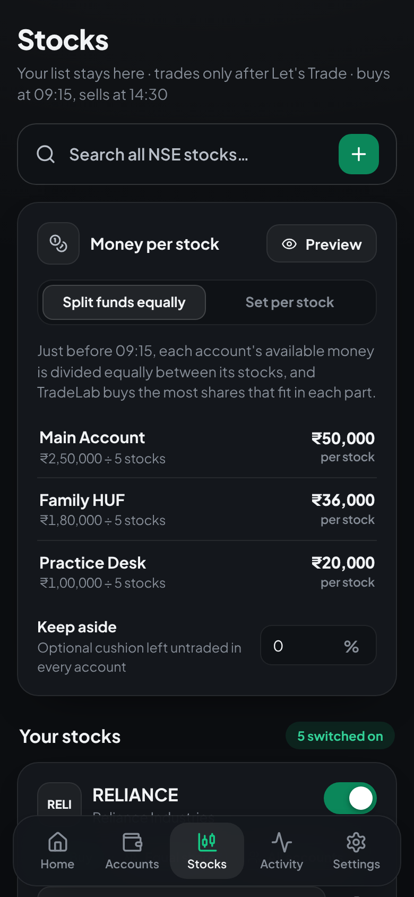

# TradeLab — intraday autopilot for many Kotak Neo accounts

TradeLab is a private app for running the same intraday plan across all your Kotak Neo demat accounts:

- **09:15:00 IST**: market orders (intraday/MIS) for every stock you picked, in every account, all at once.
- **14:30:00 IST**: a hard square-off. Pending orders are cancelled, every open position is closed at market price, and the app checks that the account is flat.

It installs like a normal app on **Android** and **Windows**. Everyone who uses it signs in with their own email and password and sees only their own accounts.

| Dashboard | Money per stock (Android) | Search stocks (Android) | Add account (Android) |
|---|---|---|---|
|  |  |  |  |

---

## What it does

| You asked for | How TradeLab does it |
|---|---|
| Add, rename and delete accounts. An account can be deleted only at ₹0 balance | **Accounts** page. Before deleting, TradeLab asks Kotak for the live balance. It refuses unless the balance is exactly **₹0.00** and there are no open positions. If the balance can't be checked (for example, the login is broken), it also refuses. |
| Log in to each demat account once, never again | You enter the account's Trade API details once: consumer key, mobile, UCC, MPIN and TOTP secret. TradeLab tests the login right away, then stores the details encrypted. Every trading day it generates the 6-digit TOTP itself and logs in at 09:00. If Kotak ends a session, it logs in again automatically. |
| Pick stocks, market buy at 09:15, hard sell at 14:30 | **Stocks** page has a search over every NSE equity from Kotak's scrip master. Your list stays from day to day; switch stocks on or off, choose which accounts trade each one and whether to buy or short. Square-off is retried up to 3 times until the account is flat. |
| Nothing trades until I press **Let's Trade** and confirm | A big **Let's Trade** button (Home and Stocks) opens **"Are you sure?"** with the day, stocks, accounts and money split. Only after **Yes** can that day's 09:15 buy happen. Exactly the confirmed list is traded, and every trading day needs a new confirmation. Without one, TradeLab sends **no orders at all**: no buys, and no 14:30 square-off. The automatic square-off only runs in accounts where TradeLab itself bought that day, so your own Kotak trades are never touched by it. |
| Automatic holiday detection | TradeLab downloads NSE's trading-holiday calendar every morning, so Let's Trade always targets the next real trading day. At 09:14 it also checks live prices of large stocks. If the market is clearly closed, it skips the day with no orders. To avoid skipping a real day by mistake, it re-checks 20 seconds after the open first. |
| Split each account's money equally across the day's stocks and buy the maximum shares | This is the default (**Stocks → Money per stock → Split funds equally**). A minute before entry, TradeLab reads each account's available funds and divides them by the number of stocks that account will trade. For each stock it buys as many shares as fit in that part. Example: ₹1,00,000 and 10 stocks gives ₹10,000 per stock, so a ₹245 stock gets 40 shares. A stock whose single share costs more than its part is skipped. **Preview orders** shows the exact quantities beforehand. |
| Sign up and log in | Create an account with name, email and password and you're in straight away. Each person gets a private space. |
| Private | Nothing is visible without logging in, and search engines are blocked (`noindex`, `robots.txt`). Each user sees only their own accounts, stocks and trades. Kotak credentials are encrypted at rest. |
| A pleasant look that works on phone and laptop | Calm dark and light themes in neutral greys. Green is kept for buttons, switches and gains, red for losses. The dashboard shows a live countdown to the next 09:15 or 14:30 event. |

Other features:

- **Confirm before or during the session.** Pressing Let's Trade in the evening confirms the next trading day. During market hours (after 09:15, before the square-off time) it buys straight away. **Cancel** is available until the buy happens.
- **Autopilot switch on every account.** Turn an account off and it is left out of both entry and exit.
- **Square-off switch.** Turn the automatic 14:30 square-off on or off, and change the buy and sell times.
- **"Square off everything now"** button, plus square-off for a single account.
- **Positions and orders view** for each account, with funds and today's P&L across all accounts.
- **Activity log** showing every order: placed, failed or skipped, and why.
- **Per-stock sizing** (optional): switch to **Set per stock** to give each stock a fixed number of shares, a ₹ amount or a % of funds.
- **Keep aside**: an optional % of each account's money that the equal split leaves untraded.
- **Holiday calendar** in Settings: NSE's calendar is loaded automatically, live-detected closures are added, and you can add or remove dates by hand. It is shared by everyone on the server.
- **Paper (practice) accounts** to dry-run the whole flow without real money.

---

## How it works

```
 Android phone ─┐                         ┌───────────── your server (always on) ─────────────┐
                ├── HTTPS ──▶ Caddy ──▶   │  TradeLab API + scheduler (Python, FastAPI)        │ ──▶ Kotak Neo Trade API
 Windows laptop ┘                         │  SQLite DB (encrypted Kotak logins)                │     (official kotakneoapi SDK)
                                          └────────────────────────────────────────────────────┘
```

Orders are placed by the **server**, not by your phone. Your phone and laptop can be switched off at 09:15; the trades still happen.

Daily timeline (IST, Mon–Fri, skipping holidays):

| Time | What happens |
|---|---|
| 08:30 | Downloads NSE's holiday calendar |
| 09:00 | Refreshes the NSE stock list and logs in the accounts of everyone who confirmed today with Let's Trade |
| 09:14:00 | Only if today was confirmed: checks the market is open, reads each account's available funds and the latest prices (retrying, with other Kotak accounts as backup), and works out the shares per stock. Not confirmed means nothing more happens. |
| **09:15:00** | Sends every MKT / MIS / DAY order in parallel across all accounts |
| **14:30:00** | Only in accounts where TradeLab bought today: cancel pending orders → close every open position at market → re-check, up to 3 attempts |

If the server was down at 14:30 and comes back before 15:20, it squares off immediately. A holiday added by mistake after TradeLab bought cannot stop the square-off. The entry runs at most once per day. Two square-offs can never run at the same time, so a position is never closed twice by mistake.

---

## Setup

### 1. Prepare each Kotak Neo account (once per account)

In the **Kotak Neo app**:

1. Go to **More → Trade API** and create an application. Copy its token; this is the **consumer key**.
2. On the same screen, **register TOTP**. When the QR code appears, **take a screenshot of it** (or copy the key shown with it) before scanning it into Google Authenticator. TradeLab needs that secret to log in by itself. On the "Add account" screen you can upload the screenshot and the secret is read from the QR code.
3. Note your **UCC** (Profile) and your **MPIN**.
4. If the Trade API dashboard asks for a **static IP**, enter your server's public IP (step 2 below).

> API trading in India is regulated (SEBI's framework for retail algo/API trading), and brokers can require static-IP registration and other steps. Check Kotak Neo's current Trade API terms for your accounts.

### 2. Run the server

You need a small always-on Linux server, ideally in the **Mumbai** region (low latency to NSE) with a **static IP**. For example, a 1 vCPU / 1–2 GB VPS from AWS Lightsail, DigitalOcean or Azure. Point a domain or subdomain (for example `trade.yourdomain.com`) at its IP.

```bash
# on the server (with Docker installed)
git clone <this repo> tradelab && cd tradelab
cp .env.example .env
nano .env          # set DOMAIN
docker compose up -d --build
```

Caddy gets an HTTPS certificate automatically. Open `https://your-domain` and choose **Create an account**.

**To share TradeLab**, send someone the address. They create their own account and get their own private space for their accounts, stocks and schedule. Anyone who knows the address can create an account, so share it only with people you choose.

**Back up the `tradelab-data` Docker volume.** It holds the database and the encryption key. If the key is lost, every account has to be added again.

### 3. Add accounts and stocks

1. **Accounts → Add account → Kotak Neo (live).** Enter the details from step 1. TradeLab logs in immediately, and if it says *Connected*, you're done with that account for good.
2. **Stocks → Search all NSE stocks.** Add your stocks. The list stays until you change it. By default each account's money is split equally between them; tap **Preview orders** to see the exact shares per account.
3. **Press Let's Trade** (Home or Stocks) and confirm. Do this for every day you want to trade.
4. On **Home**, check that *Hard square-off at 14:30* is switched on.
5. In **Settings → Market holidays**, check that NSE's calendar loaded (or add holidays by hand if your server can't reach NSE).

**Do a test run first.** Add a *Paper (practice)* account, press **Let's Trade** during market hours (it buys right away), then **Square off everything now**. For the first live day, switch **Stocks → Money per stock** to **Set per stock** and give each stock **1 share**. Check **Preview orders**, and switch back to **Split funds equally** once you're happy.

### 4. Install the app

- **Android**: open your domain in Chrome, then **⋮ → Install app** (or *Add to Home screen*).
- **Windows**: open your domain in Edge or Chrome, then click the **Install** icon in the address bar. TradeLab then opens from the Start menu like any other app.

---

## Running it on your own PC (optional)

`start-local.bat` (Windows) or `./start-local.sh` (Linux/macOS) runs everything on `http://localhost:8000`. You need Python 3.11+ and Node.js 20+.

Orders only fire while that PC is on and awake at 09:15 and 14:30. That is why a small always-on server is the recommended setup.

---

## Configuration (`.env`)

| Variable | Default | Meaning |
|---|---|---|
| `DOMAIN` | — | Domain Caddy serves over HTTPS |
| `TRADELAB_SECRET_KEY` | auto-generated in the data volume | Encrypts stored Kotak credentials and signs logins |
| `TRADELAB_ENABLE_PAPER_TRADING` | `true` | Allow practice accounts |
| `TRADELAB_TOKEN_TTL_HOURS` | `168` | How long a device stays logged in |
| `TRADELAB_DATA_DIR` | `/data` in Docker | Database, key and caches |

Run **exactly one** server process. The scheduler lives inside it, so more workers would fire orders more than once.

---

## Development

```bash
# backend
cd backend
python -m venv .venv && . .venv/bin/activate
pip install -r requirements-dev.txt
pytest                                   # 80 tests: Let's Trade gate, holidays, equal split, ₹0 delete rule, entry timing, square-off, Kotak adapter, DB upgrade
uvicorn app.main:app --reload            # http://127.0.0.1:8000

# frontend (separate terminal)
cd frontend
npm install
npm run dev                              # http://localhost:5173, proxies /api to :8000
```

Project layout:

```
backend/app/
  broker/kotak.py      Kotak Neo adapter (official kotakneoapi SDK: TOTP login, orders, positions, limits, quotes, scrip master)
  broker/paper.py      Simulated broker for practice accounts
  broker/manager.py    One session per account, automatic daily / on-expiry re-login
  services/trading.py  09:15 entry engine and 14:30 square-off engine
  services/scheduler.py APScheduler jobs (IST), catch-up after restarts
  services/scrips.py   NSE instrument list + search
  routers/             auth, accounts, stocks, basket, automation, holidays
frontend/src/          React + TypeScript PWA (pages/, components/, lib/)
```

## Notes and limits

- The Kotak integration follows the official SDK (`kotakneoapi` 3.0.7) and its documented responses. It was tested against that SDK with mocked HTTP responses, not against a live Kotak account. **Do a paper run and a 1-share live run first.**
- Orders are intraday (**MIS**) market orders with DAY validity. Kotak's own risk system also auto-squares MIS positions near 15:15–15:20, so keep the exit time before that.
- "Square-off closes **Everything**" (the default) closes every position Kotak lists for an account TradeLab bought in that day, including delivery (CNC) or F&O positions that show up there. Switch to **Intraday (MIS) only** in Settings if you don't want that.
- NSE sometimes blocks automated downloads from cloud servers. If **Settings → Market holidays** shows a download error, add the year's holidays by hand. The live 09:14 check (it needs a connected Kotak account) still protects you.
- **Equal split uses the full available amount by default.** If prices jump at the open, Kotak can reject an order for insufficient funds. Market orders at 09:15 can fill at a different price than the quote taken a minute earlier. Set a small **Keep aside** (for example 2%) if you see such rejections in Activity.
